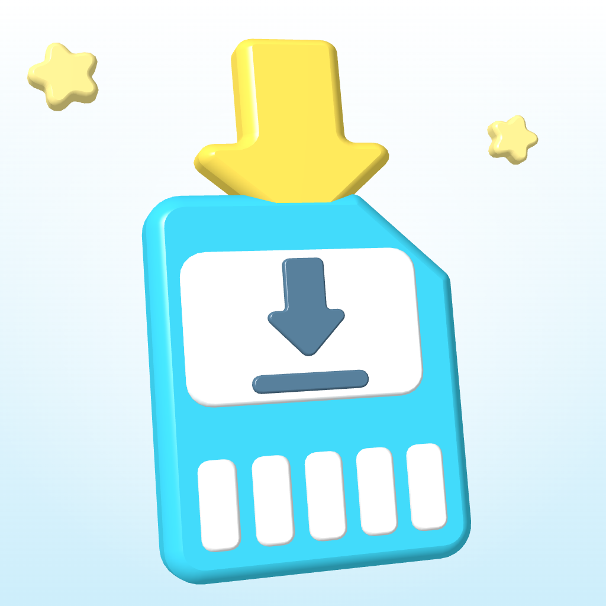

<p align="center">
  
</p>

<h1 align="center">3dsDL</h1>

<p align="center">
  Download files directly to your Nintendo 3DS from a URL or QR code.<br>
  No SD-card juggling required.
</p>

<p align="center">
  
  
  
  
</p>

<p align="center">
  <a href="#features">Features</a> ·
  <a href="#install">Install</a> ·
  <a href="#using-3dsdl">Usage</a> ·
  <a href="#building">Build</a> ·
  <a href="ROADMAP.md">Roadmap</a>
</p>

---

3dsDL is a modernized Nintendo 3DS homebrew downloader. Scan a QR code or
enter a direct HTTP/HTTPS URL, choose an SD-card destination, and save the file
without powering down the console or removing its SD card.

> [!IMPORTANT]
> Version 0.2.0 is a development build. The download engine has been verified
> on New Nintendo 3DS hardware. The redesigned interface and corrected camera
> renderer still need their final New/Old 3DS hardware compatibility pass.

## Features

- QR-code scanning through the console camera
- Manual URL entry using the Nintendo 3DS software keyboard
- Verified HTTPS using an embedded Mozilla CA certificate bundle
- HTTP redirects with HTTP/HTTPS-only protocol restrictions
- Streaming downloads that do not hold the complete file in memory
- Persistent, user-selectable download folder on the SD card
- Download progress display and cancellation with <kbd>B</kbd>
- Server-provided filename support through `Content-Disposition`
- Automatic cleanup of incomplete downloads
- A safe file-conflict prompt with three choices:
    - **Rename** keeps both files using names such as `file (1).zip`
    - **Overwrite** replaces the old file with rollback protection
    - **Cancel** leaves the existing file untouched
- Citro2D interface with both button and touch input

## Install

### What you need

- A Nintendo 3DS capable of launching `.3dsx` homebrew
- A network connection configured on the console
- The `3dsDL.3dsx` or `3dsDL.cia` release artifact

### SD-card layout

Create the application folder and place the executable here:

```text
sdmc:/3ds/3dsDL/3dsDL.3dsx
```

Launch **3dsDL** from the Homebrew Launcher. If you already run an FTP server
such as FTPD on the console, you can transfer new builds wirelessly.

Alternatively, install `3dsDL.cia` with FBI to launch 3dsDL directly from the
HOME Menu. The CIA uses the stable Title ID `0004000003D5D100`, so future CIA
builds upgrade the same installed title rather than creating duplicates.

## Using 3dsDL

1. Launch 3dsDL and check the download location shown on the top screen.
2. Select **Scan QR Code** or **Enter URL**.
3. Review the detected URL and confirm the download.
4. If the filename already exists, choose **Rename**, **Overwrite**, or
   **Cancel**.
5. Wait for the completion dialog before leaving the application.

Use **Change Folder** to enter an existing path beginning with `sdmc:/`.
3dsDL remembers the selected destination in `sdmc:/3dsDL.cfg`.

### QR-code requirements

The QR code must contain a direct URL beginning with `http://` or `https://`.
Links to JavaScript download pages, authentication forms, confirmation pages,
or websites that require browser interaction are not direct file URLs.

### Controls

| Context | Control | Action |
| --- | --- | --- |
| Main menu | D-Pad / Touch | Choose an action |
| Main menu | <kbd>A</kbd> | Open the selected action |
| Main menu | <kbd>START</kbd> | Exit 3dsDL |
| Confirmation | Left / Right + <kbd>A</kbd> | Choose and confirm |
| QR scanner | <kbd>B</kbd> | Cancel scanning |
| Download | <kbd>B</kbd> | Cancel and remove the partial file |
| Dialog | <kbd>B</kbd> | Go back or cancel |

## Building

The reproducible container build is the recommended path. It requires Docker
Desktop, or Docker CLI with Colima on macOS:

```sh
git clone git@github.com:ankushKun/3dsDL.git
cd 3dsDL
./scripts/build.sh
```

The script performs the complete build in order:

1. Checks Docker and starts Colima when necessary.
2. Obtains the pinned `devkitpro/devkitarm:20260610` image and builds the
   checksum-verified CIA tools image when it is not cached.
3. Validates that the launcher PNG contains a real alpha channel.
4. Cleans previous build outputs.
5. Compiles 3dsDL and validates the generated artifacts.
6. Creates the HOME Menu banner and packages both 3DSX and CIA builds.
7. Writes release artifacts and their SHA-256 checksums to `dist/`.
8. Removes intermediate files so the repository root remains clean.

The resulting package contains:

```text
dist/
├── 3dsDL.3dsx
├── 3dsDL.cia
├── 3dsDL.smdh
└── 3dsDL.sha256
```

### Build options

```sh
# Use more compiler jobs
THREEDSDL_BUILD_JOBS=4 ./scripts/build.sh

# Select another devkitPro image
THREEDSDL_BUILD_IMAGE=devkitpro/devkitarm:20260610 ./scripts/build.sh

# Select another CIA packaging image
THREEDSDL_CIA_IMAGE=3dsdl-cia-tools:1.0.1 ./scripts/build.sh

# Leave a Colima instance started by the script running afterward
THREEDSDL_KEEP_COLIMA=1 ./scripts/build.sh
```

For a native build, install devkitARM, libctru, Citro2D, Citro3D, 3ds-curl,
3ds-mbedTLS, and their dependencies, then run `make`.

## Project status

Version **0.2.0** focuses on hardware stabilization, the Citro2D interface,
camera correctness, and safe download behavior. Planned quality-of-life work
includes speed and ETA reporting, download history, retries, destination
presets, sleep prevention, and optional resumable downloads. See the full
[roadmap](ROADMAP.md).

Bug reports and focused pull requests are welcome through
[GitHub Issues](https://github.com/ankushKun/3dsDL/issues).

## Maintainer

**ankushKun** — [GitHub](https://github.com/ankushKun) ·
[X / Twitter](https://x.com/ankushKun_)

## License

3dsDL is distributed under the [GNU General Public License v3.0](LICENSE).
Bundled third-party components retain their respective notices; see
[LICENSE-quirc.md](LICENSE-quirc.md).
