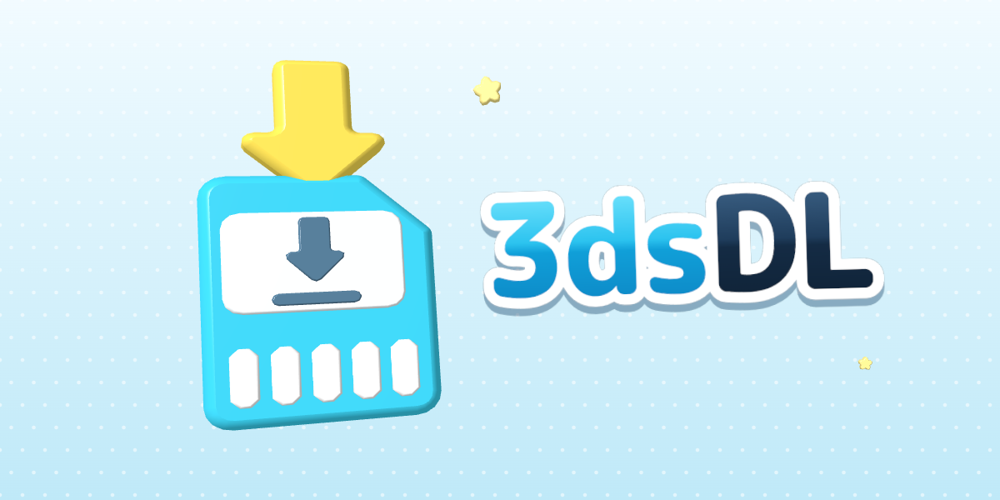
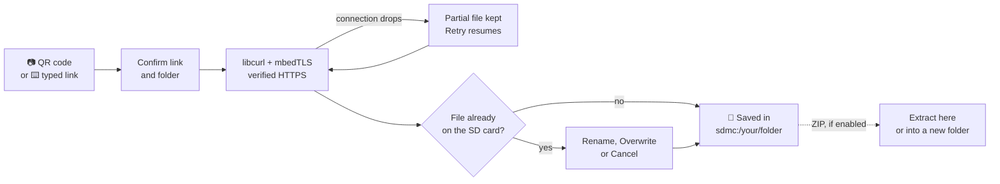

<p align="center">
  
</p>

<p align="center">
  <b>Download files straight onto your Nintendo 3DS from a URL or a QR code.</b><br>
  No pulling the SD card, no powering down, no computer in the loop.
</p>

<p align="center">
  
  
  
  
</p>

<p align="center">
  <a href="https://ankushkun.github.io/3dsDL/"><b>Website</b></a> &nbsp;•&nbsp;
  <a href="#-features">Features</a> &nbsp;•&nbsp;
  <a href="#-install">Install</a> &nbsp;•&nbsp;
  <a href="#%EF%B8%8F-using-3dsdl">Usage</a> &nbsp;•&nbsp;
  <a href="#%EF%B8%8F-building">Build</a> &nbsp;•&nbsp;
  <a href="#-testing">Tests</a> &nbsp;•&nbsp;
  <a href="ROADMAP.md">Roadmap</a> &nbsp;•&nbsp;
  <a href="#-credits">Credits</a>
</p>

<br>

Getting a file onto a 3DS usually means powering it off, pulling the SD card and finding a card reader. 3dsDL skips all of that. Point the camera at a QR code, or type a direct link with the on-screen keyboard, pick a folder, and the file streams straight onto the SD card while the console stays on.

It's a modern take on [Multidownload](https://github.com/hax0kartik/Multidownload), the 2017 homebrew downloader, rebuilt around libcurl and mbedTLS with a new Citro2D interface.

> [!IMPORTANT]
> Version 0.3.0 is a development build. Downloads over the internet, installing the CIA with FBI and ZIP extraction have been confirmed on a console, and the download engine, file handling, ZIP extraction and QR decoding are covered by automated tests. The rest of the New and Old 3DS hardware pass is planned in [docs/HARDWARE.md](docs/HARDWARE.md).

## ✨ Features

<table>
  <tr>
    <td width="50%" valign="top">
      <h4>📷 Scan or type</h4>
      Scan a QR code with the console camera, or enter a link with the 3DS keyboard. QR codes that aren't links are pointed out instead of ending the scan.
    </td>
    <td width="50%" valign="top">
      <h4>🔒 Real HTTPS</h4>
      Certificates are checked against a bundled Mozilla CA store, redirects stay on HTTP and HTTPS, and plain <code>http://</code> links get a warning before you download.
    </td>
  </tr>
  <tr>
    <td valign="top">
      <h4>📊 Live progress</h4>
      Speed, time left, size and percentage while the file streams straight to the SD card, with free space checked before anything is written.
    </td>
    <td valign="top">
      <h4>⏯️ Resume and retry</h4>
      A dropped connection keeps what already arrived. Retry, or pick the download from History later, and it carries on from there, but only when the server confirms the file hasn't changed.
    </td>
  </tr>
  <tr>
    <td valign="top">
      <h4>🤝 Never clobbers your files</h4>
      If a file already exists you choose: <b>Rename</b> keeps both as <code>file (1).zip</code>, <b>Overwrite</b> replaces it with rollback protection, or <b>Cancel</b> leaves it alone. A finished download is never thrown away because of an awkward filename.
    </td>
    <td valign="top">
      <h4>📁 Folders made easy</h4>
      Presets for common places like <code>sdmc:/cias/</code> and <code>sdmc:/3ds/</code>, recent folders, a folder browser that can create new folders, or type any path.
    </td>
  </tr>
  <tr>
    <td valign="top">
      <h4>🕘 History</h4>
      The last 50 downloads, saved, failed or cancelled, with their links and where they went. Download again, resume or remove any of them.
    </td>
    <td valign="top">
      <h4>🗜️ Optional ZIP extraction</h4>
      Off by default. When you turn it on, 3dsDL offers to extract a downloaded <code>.zip</code> into the same folder or a new one, asks before overwriting, and refuses paths that would escape the folder.
    </td>
  </tr>
  <tr>
    <td valign="top">
      <h4>🌙 Stays awake</h4>
      Sleep mode is paused while a download or extraction runs, so closing the lid doesn't cut the Wi-Fi halfway through.
    </td>
    <td valign="top">
      <h4>🕐 Fixes the clock</h4>
      HTTPS fails when the console's date is wrong. 3dsDL compares the clock with internet time and sets it for the time zone you pick, and certificate errors say exactly why they happened.
    </td>
  </tr>
  <tr>
    <td valign="top">
      <h4>🎮 Buttons or touch</h4>
      A Citro2D interface that works with the D-Pad, Circle Pad, buttons or touch screen everywhere, including every dialog.
    </td>
    <td valign="top">
      <h4>🧪 Tested off the console</h4>
      The download engine, ZIP extraction and QR decoding run in automated tests against a local HTTP, HTTPS and NTP fixture server on every push.
    </td>
  </tr>
</table>

## 🔄 How it works



## 📦 Install

**You'll need**

- A Nintendo 3DS that can run homebrew
- A working Wi-Fi connection set up on the console
- `3dsDL.3dsx` or `3dsDL.cia` from the [releases page](https://github.com/ankushKun/3dsDL/releases), or your own build (see [Building](#%EF%B8%8F-building))

The [website](https://ankushkun.github.io/3dsDL/) has QR codes that install the latest release straight from FBI, and a tool that turns any download link into a QR code for 3dsDL.

**Homebrew Launcher (.3dsx)**

Copy the executable to this path on the SD card and launch **3dsDL** from the Homebrew Launcher:

```text
sdmc:/3ds/3dsDL/3dsDL.3dsx
```

If you already run an FTP server such as FTPD on the console, you can send new builds over Wi-Fi instead.

**HOME Menu (.cia)**

Install `3dsDL.cia` with FBI to launch it straight from the HOME Menu. The CIA uses the stable Title ID `0004000003D5D100`, so newer builds upgrade the installed title instead of adding a duplicate.

## 🕹️ Using 3dsDL

1. Launch 3dsDL. The top screen shows the download folder, the free space on the SD card and whether Wi-Fi is connected.
2. Pick **Scan QR Code** or **Enter URL**.
3. Check the link and the folder on the confirm screen. **Folder** lets you change where it goes.
4. Watch the progress screen. Leave it running, or cancel with <kbd>B</kbd>.
5. If a file with that name already exists, choose **Rename**, **Overwrite** or **Cancel**.

If the connection drops, the error dialog offers **Retry**, which continues from where it stopped. The same download can also be resumed later from **History**.

> [!TIP]
> The quickest way to send a link from your computer is to turn it into a QR code right in the terminal and scan it off the screen:
>
> ```sh
> qrencode -t ansiutf8 "https://example.com/some-homebrew.3dsx"
> ```

The QR code has to contain a **direct** link starting with `http://` or `https://`. Links to download pages that need JavaScript, a login, a confirmation click or anything else that needs a browser won't work, because 3dsDL only fetches the file itself.

### Controls

| Where | Input | What it does |
| --- | --- | --- |
| Home | D-Pad, Circle Pad or touch | Choose an action |
| Home | <kbd>A</kbd> | Open the selected action |
| Home | <kbd>START</kbd> | Exit 3dsDL |
| Dialogs | Left / Right, then <kbd>A</kbd>, or touch | Choose a button |
| Dialogs | <kbd>B</kbd> | Go back or cancel |
| Lists | Up / Down, <kbd>L</kbd> / <kbd>R</kbd> to page, tap twice to open | Move and open |
| Folder browser | <kbd>X</kbd> / <kbd>Y</kbd> | New folder / use the current folder |
| History | <kbd>X</kbd> | Clear the history |
| QR scanner | <kbd>B</kbd> | Stop scanning |
| Download | <kbd>B</kbd> | Ask to cancel |

### Settings

| Setting | Default | What it does |
| --- | --- | --- |
| Resume interrupted downloads | On | Keep partial downloads and continue them with HTTP range requests. 3dsDL only resumes when the server sends a strong ETag or a Last-Modified date, and starts over if the file changed. |
| Stay awake while downloading | On | Pause sleep mode during downloads and extraction so closing the lid doesn't drop Wi-Fi. |
| Offer to extract ZIP files | Off | After a `.zip` finishes, ask whether to extract it. |
| Default download folder | `sdmc:/` | Where new downloads go. |
| Console clock | | Shows the console's time next to internet time and sets the clock for your time zone. The time zone you pick is remembered. |

> [!NOTE]
> Setting the clock needs the CIA build, which asks for access to the clock service. If 3dsDL isn't allowed to change it, open Rosalina with <kbd>L</kbd> + <kbd>Down</kbd> + <kbd>Select</kbd> and use **Miscellaneous options → Update time and date via NTP** instead.

### Files on the SD card

| Path | Contents |
| --- | --- |
| `sdmc:/3ds/3dsDL/settings.ini` | Settings. Version 0.2's `sdmc:/3dsDL.cfg` is moved here automatically. |
| `sdmc:/3ds/3dsDL/history.txt` | The last 50 downloads. |
| `<folder>/.3dsdl-<id>.part` and `.resume` | A partial download kept for resuming, removed once it finishes, is cancelled or is removed from History. |

## 🛠️ Building

The recommended way is the reproducible container build. All it needs is Docker Desktop, or the Docker CLI with Colima on macOS:

```sh
git clone https://github.com/ankushKun/3dsDL.git
cd 3dsDL
./scripts/build.sh
```

When it finishes, everything you need is in `dist/`:

```text
dist/
├── 3dsDL.3dsx     Homebrew Launcher build
├── 3dsDL.cia      HOME Menu install
├── 3dsDL.smdh     icon and title metadata
└── 3dsDL.sha256   checksums for all of the above
```

<details>
<summary><b>What the build script does</b></summary>

<br>

1. Checks that Docker is available and starts Colima if it needs to.
2. Pulls the digest-pinned `devkitpro/devkitarm:20260610` image and builds the checksum-verified CIA tools image if it isn't cached yet.
3. Makes sure the launcher icon PNG has a real alpha channel.
4. Cleans out previous build output.
5. Compiles 3dsDL, running the containers as your user so nothing in the repository ends up owned by root.
6. Creates the HOME Menu banner and packages both the 3DSX and CIA builds, taking the version from the `VERSION` file.
7. Writes the release files and their SHA-256 checksums to `dist/`.
8. Removes intermediate files so the repository root stays clean.

</details>

<details>
<summary><b>Build options</b></summary>

<br>

```sh
# Use more compiler jobs
THREEDSDL_BUILD_JOBS=4 ./scripts/build.sh

# Use another devkitPro image (the default is pinned by digest)
THREEDSDL_BUILD_IMAGE=devkitpro/devkitarm:20260610 ./scripts/build.sh

# Use another CIA packaging image
THREEDSDL_CIA_IMAGE=3dsdl-cia-tools:1.0.2 ./scripts/build.sh

# Leave a Colima instance the script started running afterwards
THREEDSDL_KEEP_COLIMA=1 ./scripts/build.sh
```

</details>

<details>
<summary><b>Building without Docker</b></summary>

<br>

Install devkitARM, libctru, Citro2D, Citro3D, 3ds-curl, 3ds-mbedTLS and their dependencies through devkitPro's pacman, then run `make` in the repository root.

</details>

<details>
<summary><b>Reproducibility and releases</b></summary>

<br>

Building the same commit twice gives a byte-identical `3dsDL.3dsx`. The CIA is identical too, except for the ticket ID, title key and content ID that makerom randomises on every run; the packaged app inside it does not change.

GitHub Actions runs the tests and the container build on every push and pull request and keeps `dist/` as a build artifact. Pushing a tag such as `v0.3.0` that matches `VERSION` also creates a draft release with the 3DSX, CIA, SMDH and checksums attached, ready to review and publish.

</details>

## 🧪 Testing

Everything that doesn't need console hardware builds and runs on a normal computer: link and filename handling, the settings and history formats, the download engine, ZIP extraction, QR decoding and the internet time client. The tests run under AddressSanitizer and UBSan.

```sh
make -C tests check
```

You need a C++17 compiler, libcurl and zlib development headers, Python 3 and OpenSSL. The integration tests start [`tests/fixtures/server.py`](tests/fixtures/server.py), a local HTTP, HTTPS and NTP server with a throwaway certificate, and drive the real download engine through redirects, chunked responses, TLS failures, dropped and stalled connections, resume, cancellation, a full SD card and oversized files. The QR tests draw codes into camera-sized frames and decode them through the same code the scanner uses.

The parts that need a console (camera, graphics, keyboard, Wi-Fi and sleep) are covered by the checklist in [docs/HARDWARE.md](docs/HARDWARE.md).

<details>
<summary><b>Project layout</b></summary>

<br>

```text
source/app/    3DS-only code: screens, UI toolkit, camera scanner, worker threads
source/core/   portable logic: naming, links, settings, history, ZIP, image maths
source/net/    portable download engine on libcurl
source/quirc/  vendored QR decoder (see VENDORED.md)
tests/         host tests, fixture server and ZIP fixtures
site/          the website, deployed to GitHub Pages
```

</details>

## 🗺️ Roadmap

Version **0.3.0** brings the download quality-of-life work and the 1.0 test and release tooling. Next up:

- [ ] Hardware pass on New and Old 3DS using [docs/HARDWARE.md](docs/HARDWARE.md)
- [ ] 1.0 once that pass is clean
- [ ] Afterwards: sending links from a phone or computer browser, and checksums for finished downloads

The full plan lives in [ROADMAP.md](ROADMAP.md). Bug reports and focused pull requests are very welcome over in [Issues](https://github.com/ankushKun/3dsDL/issues).

## 💙 Credits

3dsDL stands on the shoulders of these projects:

- [**Multidownload**](https://github.com/hax0kartik/Multidownload) by [hax0kartik](https://github.com/hax0kartik), the original 3DS URL and QR downloader that this project grew out of
- [**quirc**](https://github.com/dlbeer/quirc) by Daniel Beer, for QR code decoding (see [LICENSE-quirc.md](LICENSE-quirc.md))
- [**QR Code generator**](https://www.nayuki.io/page/qr-code-generator-library) by Project Nayuki (MIT), used only by the tests to draw QR codes
- [**libcurl**](https://curl.se/) and [**Mbed TLS**](https://github.com/Mbed-TLS/mbedtls), for downloads and HTTPS
- The [Mozilla CA certificate bundle](https://curl.se/docs/caextract.html), for checking who you're talking to
- [**devkitPro**](https://devkitpro.org/), **libctru** and **Citro2D**, which make 3DS homebrew possible at all

## 📄 License

3dsDL is released under the [GNU General Public License v3.0](LICENSE). Bundled third-party components keep their own notices.

<br>

<p align="center">
  <br>
  Made by <a href="https://ankush.one">ankushKun</a> &nbsp;•&nbsp; <a href="https://github.com/ankushKun">GitHub</a> &nbsp;•&nbsp; <a href="https://x.com/ankushKun_">X</a>
</p>
