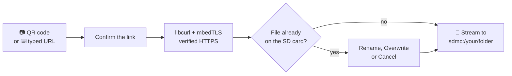

<p align="center">
  
</p>

<p align="center">
  <b>Download files straight onto your Nintendo 3DS from a URL or a QR code.</b><br>
  No pulling the SD card, no powering down, no computer in the loop.
</p>

<p align="center">
  
  
  
  
</p>

<p align="center">
  <a href="#-features">Features</a> &nbsp;•&nbsp;
  <a href="#-install">Install</a> &nbsp;•&nbsp;
  <a href="#%EF%B8%8F-using-3dsdl">Usage</a> &nbsp;•&nbsp;
  <a href="#%EF%B8%8F-building">Build</a> &nbsp;•&nbsp;
  <a href="ROADMAP.md">Roadmap</a> &nbsp;•&nbsp;
  <a href="#-credits">Credits</a>
</p>

<br>

Getting a file onto a 3DS usually means powering it off, pulling the SD card and finding a card reader. 3dsDL skips all of that. Point the camera at a QR code, or type a direct link with the on-screen keyboard, pick a folder, and the file streams straight onto the SD card while the console stays on.

It's a modern take on [Multidownload](https://github.com/hax0kartik/Multidownload), the 2017 homebrew downloader, rebuilt around libcurl and mbedTLS with a new Citro2D interface.

> [!IMPORTANT]
> Version 0.2.0 is a development build. The download engine has been verified on New Nintendo 3DS hardware, while the redesigned interface and the corrected camera renderer are still waiting on their final New and Old 3DS compatibility pass.

## ✨ Features

<table>
  <tr>
    <td width="50%" valign="top">
      <h4>📷 Scan or type</h4>
      Scan a QR code with the console camera, or enter a URL with the 3DS software keyboard.
    </td>
    <td width="50%" valign="top">
      <h4>🔒 Real HTTPS</h4>
      Certificates are verified against a bundled Mozilla CA store, and redirects are followed but kept to HTTP and HTTPS.
    </td>
  </tr>
  <tr>
    <td valign="top">
      <h4>💾 Streams to the SD card</h4>
      Big files are written as they arrive instead of being held in memory, and half-finished downloads are cleaned up automatically.
    </td>
    <td valign="top">
      <h4>🏷️ Proper filenames</h4>
      Uses the name the server sends through <code>Content-Disposition</code>, and remembers the folder you picked last time.
    </td>
  </tr>
  <tr>
    <td valign="top">
      <h4>🤝 Never clobbers your files</h4>
      If a file already exists you choose: <b>Rename</b> keeps both as <code>file (1).zip</code>, <b>Overwrite</b> replaces it with rollback protection, or <b>Cancel</b> leaves it alone.
    </td>
    <td valign="top">
      <h4>🎮 Buttons or touch</h4>
      A Citro2D interface that works with the D-Pad and buttons or the touch screen, with live progress you can cancel any time with <kbd>B</kbd>.
    </td>
  </tr>
</table>

## 🔄 How it works



## 📦 Install

**You'll need**

- A Nintendo 3DS that can run homebrew
- A working Wi-Fi connection set up on the console
- `3dsDL.3dsx` or `3dsDL.cia` from the [releases page](https://github.com/ankushKun/3dsDL/releases), or your own build (see [Building](#%EF%B8%8F-building))

**Homebrew Launcher (.3dsx)**

Copy the executable to this path on the SD card and launch **3dsDL** from the Homebrew Launcher:

```text
sdmc:/3ds/3dsDL/3dsDL.3dsx
```

If you already run an FTP server such as FTPD on the console, you can send new builds over Wi-Fi instead.

**HOME Menu (.cia)**

Install `3dsDL.cia` with FBI to launch it straight from the HOME Menu. The CIA uses the stable Title ID `0004000003D5D100`, so newer builds upgrade the installed title instead of adding a duplicate.

## 🕹️ Using 3dsDL

1. Launch 3dsDL and check the download folder shown on the top screen.
2. Pick **Scan QR Code** or **Enter URL**.
3. Check the link it found and confirm the download.
4. If a file with that name already exists, choose **Rename**, **Overwrite** or **Cancel**.
5. Wait for the completion dialog before closing the app.

Use **Change Folder** to pick any existing path that starts with `sdmc:/`. Your choice is saved in `sdmc:/3dsDL.cfg`.

> [!TIP]
> The quickest way to send a link from your computer is to turn it into a QR code right in the terminal and scan it off the screen:
>
> ```sh
> qrencode -t ansiutf8 "https://example.com/some-homebrew.3dsx"
> ```

The QR code has to contain a **direct** link starting with `http://` or `https://`. Links to download pages that need JavaScript, a login, a confirmation click or anything else that needs a browser won't work, because 3dsDL only fetches the file itself.

### Controls

| Where | Input | What it does |
| --- | --- | --- |
| Main menu | D-Pad / Touch | Choose an action |
| Main menu | <kbd>A</kbd> | Open the selected action |
| Main menu | <kbd>START</kbd> | Exit 3dsDL |
| Confirmation | Left / Right, then <kbd>A</kbd> | Choose and confirm |
| QR scanner | <kbd>B</kbd> | Stop scanning |
| Download | <kbd>B</kbd> | Cancel and delete the partial file |
| Dialog | <kbd>B</kbd> | Go back or cancel |

## 🛠️ Building

The recommended way is the reproducible container build. All it needs is Docker Desktop, or the Docker CLI with Colima on macOS:

```sh
git clone https://github.com/ankushKun/3dsDL.git
cd 3dsDL
./scripts/build.sh
```

When it finishes, everything you need is in `dist/`:

```text
dist/
├── 3dsDL.3dsx     Homebrew Launcher build
├── 3dsDL.cia      HOME Menu install
├── 3dsDL.smdh     icon and title metadata
└── 3dsDL.sha256   checksums for all of the above
```

<details>
<summary><b>What the build script does</b></summary>

<br>

1. Checks that Docker is available and starts Colima if it needs to.
2. Pulls the pinned `devkitpro/devkitarm:20260610` image and builds the checksum-verified CIA tools image if it isn't cached yet.
3. Makes sure the launcher icon PNG has a real alpha channel.
4. Cleans out previous build output.
5. Compiles 3dsDL and validates what it produced.
6. Creates the HOME Menu banner and packages both the 3DSX and CIA builds.
7. Writes the release files and their SHA-256 checksums to `dist/`.
8. Removes intermediate files so the repository root stays clean.

</details>

<details>
<summary><b>Build options</b></summary>

<br>

```sh
# Use more compiler jobs
THREEDSDL_BUILD_JOBS=4 ./scripts/build.sh

# Use another devkitPro image
THREEDSDL_BUILD_IMAGE=devkitpro/devkitarm:20260610 ./scripts/build.sh

# Use another CIA packaging image
THREEDSDL_CIA_IMAGE=3dsdl-cia-tools:1.0.1 ./scripts/build.sh

# Leave a Colima instance the script started running afterwards
THREEDSDL_KEEP_COLIMA=1 ./scripts/build.sh
```

</details>

<details>
<summary><b>Building without Docker</b></summary>

<br>

Install devkitARM, libctru, Citro2D, Citro3D, 3ds-curl, 3ds-mbedTLS and their dependencies through devkitPro's pacman, then run `make` in the repository root.

</details>

## 🗺️ Roadmap

Version **0.2.0** is all about hardware stability, the new Citro2D interface, a camera that renders correctly and downloads that are safe by default. Next up:

- [ ] Hardware check of the camera and QR decoding on New and Old 3DS
- [ ] Download speed, ETA, transferred size and free SD space
- [ ] Download history, retries and destination presets
- [ ] Keeping the console awake during a download
- [ ] Optional resumable downloads over HTTP ranges

The full plan up to 1.0 lives in [ROADMAP.md](ROADMAP.md). Bug reports and focused pull requests are very welcome over in [Issues](https://github.com/ankushKun/3dsDL/issues).

## 💙 Credits

3dsDL stands on the shoulders of these projects:

- [**Multidownload**](https://github.com/hax0kartik/Multidownload) by [hax0kartik](https://github.com/hax0kartik), the original 3DS URL and QR downloader that this project grew out of
- [**quirc**](https://github.com/dlbeer/quirc) by Daniel Beer, for QR code decoding (see [LICENSE-quirc.md](LICENSE-quirc.md))
- [**libcurl**](https://curl.se/) and [**Mbed TLS**](https://github.com/Mbed-TLS/mbedtls), for downloads and HTTPS
- The [Mozilla CA certificate bundle](https://curl.se/docs/caextract.html), for checking who you're talking to
- [**devkitPro**](https://devkitpro.org/), **libctru** and **Citro2D**, which make 3DS homebrew possible at all

## 📄 License

3dsDL is released under the [GNU General Public License v3.0](LICENSE). Bundled third-party components keep their own notices.

<br>

<p align="center">
  <br>
  Made by <a href="https://ankush.one">ankushKun</a> &nbsp;•&nbsp; <a href="https://github.com/ankushKun">GitHub</a> &nbsp;•&nbsp; <a href="https://x.com/ankushKun_">X</a>
</p>
